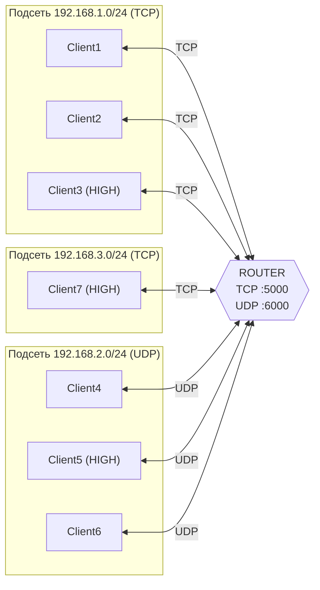

# TCP/UDP Router — учебный проект (практика 2)

Модель сети с **маршрутизатором (router)**, который принимает сообщения от клиентов по **TCP** и по **UDP**, определяет получателя, учитывает **подсети** и **приоритет** и пересылает сообщение дальше — при необходимости **на другом протоколе**.

Проект написан на Python 3, использует только стандартную библиотеку (`socket`, `json`, `threading`).

---

## Содержание

1. [Идея проекта](#идея-проекта)
2. [Структура репозитория](#структура-репозитория)
3. [Архитектура](#архитектура)
4. [Конфигурация клиентов](#конфигурация-клиентов-clientsjson)
5. [Формат сообщений](#формат-сообщений)
6. [Как работает роутер](#как-работает-роутер)
7. [Запуск](#запуск)
8. [Сценарии для демонстрации](#сценарии-для-демонстрации)
9. [Известные ограничения](#известные-ограничения)

---

## Идея проекта

В сети есть 7 клиентов в трёх подсетях. Часть клиентов работает по TCP, часть по UDP. Напрямую друг с другом они не общаются — всё идёт через роутер:

- клиент **регистрируется** на роутере (называет своё имя);
- клиент отправляет сообщение в виде «кому, с каким приоритетом, что»;
- роутер **ищет получателя** в таблице клиентов, смотрит его подсеть, протокол и приоритет;
- роутер **доставляет** сообщение получателю по *его* протоколу (TCP или UDP), даже если отправитель использовал другой.

Так моделируются три вещи: **маршрутизация между подсетями**, **преобразование протоколов** (TCP ↔ UDP) и **приоритизация трафика**.

---

## Структура репозитория

| Файл | Назначение |
|---|---|
| `router.py` | Сервер-маршрутизатор. Слушает TCP (порт 5000) и UDP (порт 6000), обрабатывает и пересылает сообщения |
| `client_tcp.py` | Клиент, работающий по TCP |
| `client_udp.py` | Клиент, работающий по UDP |
| `clients.json` | Таблица клиентов: IP, подсеть, протокол, приоритет |
| `README.md` | Это описание |
| `DEFENSE.md` | Шпаргалка для защиты: рассказ по проекту и ответы на вопросы |

---

## Архитектура



### Потоки (threads) внутри роутера

- **Поток TCP-сервера** — ждёт новые подключения (`accept`). На каждого клиента запускается **отдельный поток** `handle_tcp_client`, потому что `recv()` блокирующий и без потоков роутер мог бы обслуживать только одного клиента.
- **Поток UDP-сервера** — один цикл `recvfrom` на одном сокете. UDP не имеет соединений, поэтому отдельный поток на каждого клиента не нужен: все датаграммы приходят на один сокет, а отправителя определяют по адресу `(ip, порт)`.

### Словари в роутере

- `clients` — **статическая** таблица из `clients.json` (кто вообще может быть в сети: подсеть, протокол, приоритет).
- `connected_clients` — **динамическая** таблица: кто *сейчас* подключён и как до него достучаться (сокет и адрес).

---

## Конфигурация клиентов (`clients.json`)

| Клиент | IP | Подсеть | Протокол | Приоритет |
|---|---|---|---|---|
| Client1 | 192.168.1.10 | 192.168.1.0/24 | TCP | NORMAL |
| Client2 | 192.168.1.11 | 192.168.1.0/24 | TCP | NORMAL |
| Client3 | 192.168.1.12 | 192.168.1.0/24 | TCP | **HIGH** |
| Client4 | 192.168.2.10 | 192.168.2.0/24 | UDP | NORMAL |
| Client5 | 192.168.2.11 | 192.168.2.0/24 | UDP | **HIGH** |
| Client6 | 192.168.2.12 | 192.168.2.0/24 | UDP | NORMAL |
| Client7 | 192.168.3.10 | 192.168.3.0/24 | TCP | **HIGH** |

> Реальной сети здесь нет: все процессы работают на `127.0.0.1`, а IP-адреса и подсети из JSON — **логическая модель**. Роутер использует их для сравнения (одна подсеть или разные) и для вывода в консоль.

---

## Формат сообщений

### Регистрация

```
REGISTER|<имя клиента>
```

Пример: `REGISTER|Client1`. В ответ роутер присылает `Регистрация выполнена.`

### Обычное сообщение (клиент → роутер)

```
<получатель>|<приоритет>|<текст>
```

Пример: `Client4|NORMAL|Привет!`

Разбор на стороне роутера: `message.split("|", 2)` — максимум **2** разделения, поэтому сам текст может содержать символ `|`.

### Доставленное сообщение (роутер → получатель)

```
[<приоритет>] <отправитель> → <получатель>: <текст>
```

Пример: `[HIGH] Client3 → Client4: Срочно!`

---

## Как работает роутер

Вся логика — в функции `process_message(sender, message)`:

1. **Разбор** строки на `получатель | приоритет | текст`. Если частей не три — сообщение отбрасывается («Неверный формат сообщения»).
2. **Проверка получателя** по `clients.json`. Если такого имени нет — «Получатель не найден».
3. **Автоматический приоритет (задание №4):** если у отправителя в `clients.json` стоит `HIGH`, то приоритет сообщения принудительно становится `HIGH`, что бы клиент ни ввёл.
4. **Вывод информации** о сообщении: отправитель, получатель, подсети, протоколы, приоритет, текст.
5. **Определение типа маршрута:**
   - подсети различаются → `Выполняется межсетевой маршрут`;
   - протоколы различаются → `Выполняется преобразование протокола`.
6. **Формирование** итоговой строки `[приоритет] отправитель → получатель: текст`.
7. **Отправка** функцией `send_to_client`: если получатель подключён по TCP — `socket.send()`, если по UDP — `socket.sendto(…, адрес)`. Если получатель не подключён — выводится «Клиент не подключён».

### Что такое «преобразование протокола» в этом проекте

Роутер принял сообщение по одному протоколу (например, UDP от Client4), а отправил получателю по другому (TCP для Client1). Формат полезной нагрузки одинаковый, меняется только транспорт: для TCP используется уже установленное соединение, для UDP — отправка датаграммы на сохранённый адрес.

---

## Запуск

Нужен Python 3. Сторонних библиотек нет. Все файлы должны лежать в одной папке (роутер открывает `clients.json` по относительному пути).

**1. Запустить роутер** (первым, в отдельном терминале):

```bash
python router.py
```

**2. Запустить клиентов** (каждого в своём терминале).

Имя клиента задаётся константой `NAME` в начале файла клиента. Чтобы запустить другого клиента, измените `NAME`:

- TCP-клиенты (Client1, Client2, Client3, Client7) — файл `client_tcp.py`;
- UDP-клиенты (Client4, Client5, Client6) — файл `client_udp.py`.

```bash
python client_tcp.py
python client_udp.py
```

**3. Отправить сообщение.** Клиент спросит три вещи:

```
Получатель: Client4
Приоритет (NORMAL/HIGH): normal
Сообщение: Привет!
```

Чтобы выйти, отправьте сообщение с текстом `exit`.

> Результат маршрутизации смотрите в консоли роутера — там печатается подробный разбор каждого сообщения.

---

## Сценарии для демонстрации

| # | Отправитель → Получатель | Что показывает |
|---|---|---|
| 1 | Client1 → Client2 | Одна подсеть, оба TCP: обычная доставка |
| 2 | Client1 → Client4 | Разные подсети **и** разные протоколы (TCP → UDP): межсетевой маршрут + преобразование протокола |
| 3 | Client4 → Client1 | То же в обратную сторону (UDP → TCP) |
| 4 | Client3 → Client2, приоритет `NORMAL` | Автоприоритет: Client3 имеет `HIGH`, сообщение уходит как `HIGH` |
| 5 | Client5 → Client6 | Одна подсеть, оба UDP, автоприоритет `HIGH` |
| 6 | Client7 → Client1 | Подсеть 3 → подсеть 1, оба TCP: межсетевой маршрут без смены протокола |
| 7 | Client1 → Client99 | Получатель отсутствует в `clients.json`: «Получатель не найден» |
| 8 | Client1 → Client6, когда Client6 не запущен | Получатель в конфиге есть, но не подключён: «Клиент не подключён» |

---

## Известные ограничения

Проект учебный, поэтому упрощения сделаны сознательно:

- **Клиенты не выводят входящие сообщения** — они только отправляют. Доставка видна в логе роутера.
- **Приоритет — это метка**, а не настоящая очередь: сообщения обрабатываются в порядке поступления, `HIGH` не обгоняет `NORMAL`.
- **Нет разграничения сообщений в TCP** (TCP — поток байтов): сообщения короче 1024 байт и отправляются редко, поэтому на практике это работает, но в общем случае нужен протокол с длиной сообщения или разделителем.
- **UDP не гарантирует доставку** и порядок; роутер не подтверждает получение.
- **Нет блокировок** при доступе к `connected_clients` из нескольких потоков.
- **Сообщение `exit`** клиент отправляет как обычный текст; роутер не обрабатывает его как команду. TCP-клиент отключается по закрытию соединения, а UDP-клиент остаётся в списке подключённых.
- **Имя клиента зашито** в код (`NAME`), проверки подлинности нет: роутер доверяет имени из `REGISTER`.

Возможные улучшения: поток приёма на клиентах, очередь с приоритетами (`queue.PriorityQueue`), блокировки (`threading.Lock`), подтверждения доставки для UDP, команда `EXIT`/`UNREGISTER`, логирование в файл.
